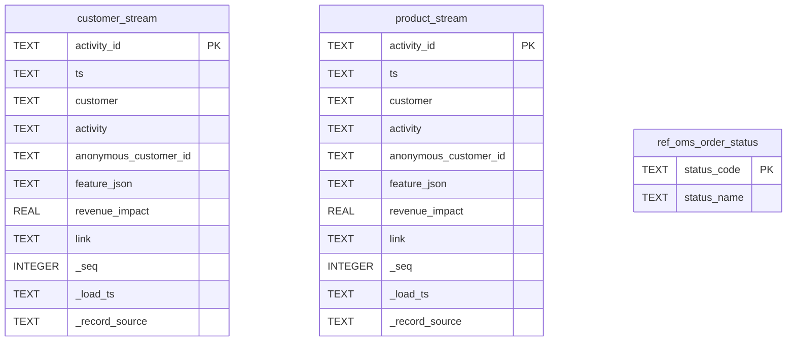
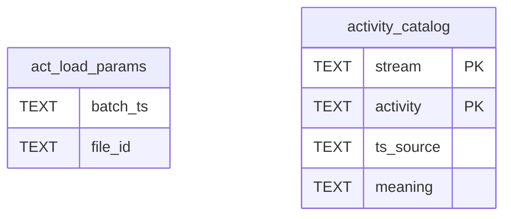
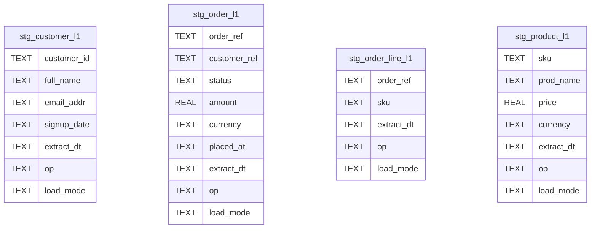
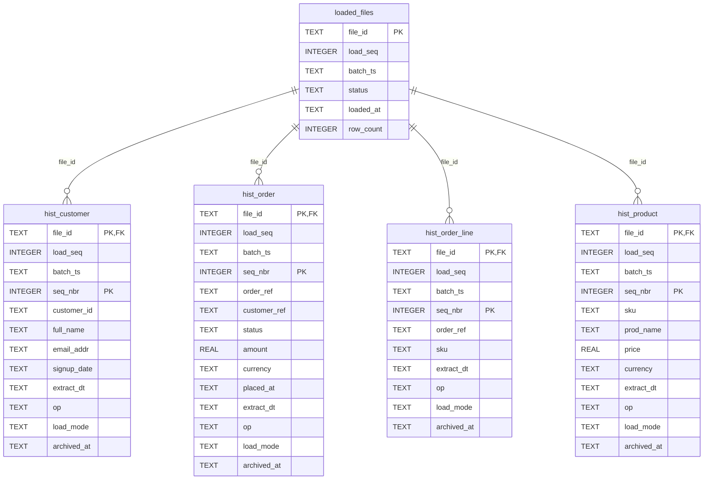

# Activity Schema — ER diagrams

Generated from [`v3_activity-schema/build/activity.db`](../../v3_activity-schema/build/activity.db) and `archive/activity_archive.db` by `er-diagrams/generate.py`. Design notes: [`v3_activity-schema/ACTIVITY.md`](../../v3_activity-schema/ACTIVITY.md).

> `PK` is a primary-key column and `FK` a declared foreign key. A solid
> line is a declared foreign key; a dashed line is a join the model
> intends but does not declare. The crow's foot is the "many" side.

## 1 · Core model

Two streams with the same fixed columns. Activities relate by who (`customer`), what (`link`) and when (`ts`), so there is nothing to draw between them. The order status code lives inside `feature_json` and is decoded on read.

## 2 · Metadata and load control

Registries, routing maps and the parameters the loaders read.

## 3 · Staging

Where a delivery lands before it is applied. Staging tables hold source names, so they have no relationships.

## 4 · Raw layer (archive)

The durable raw layer, in its own database file. Every delivery is captured here verbatim before it is applied, and the tables are append-only.

