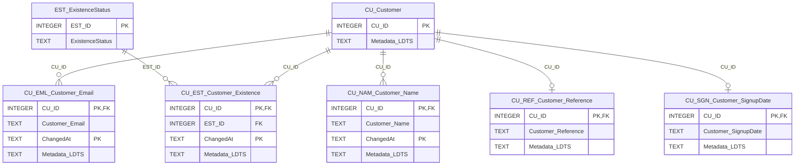
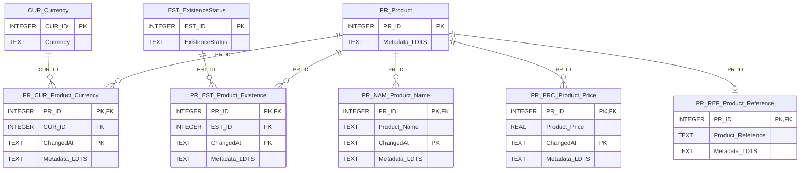
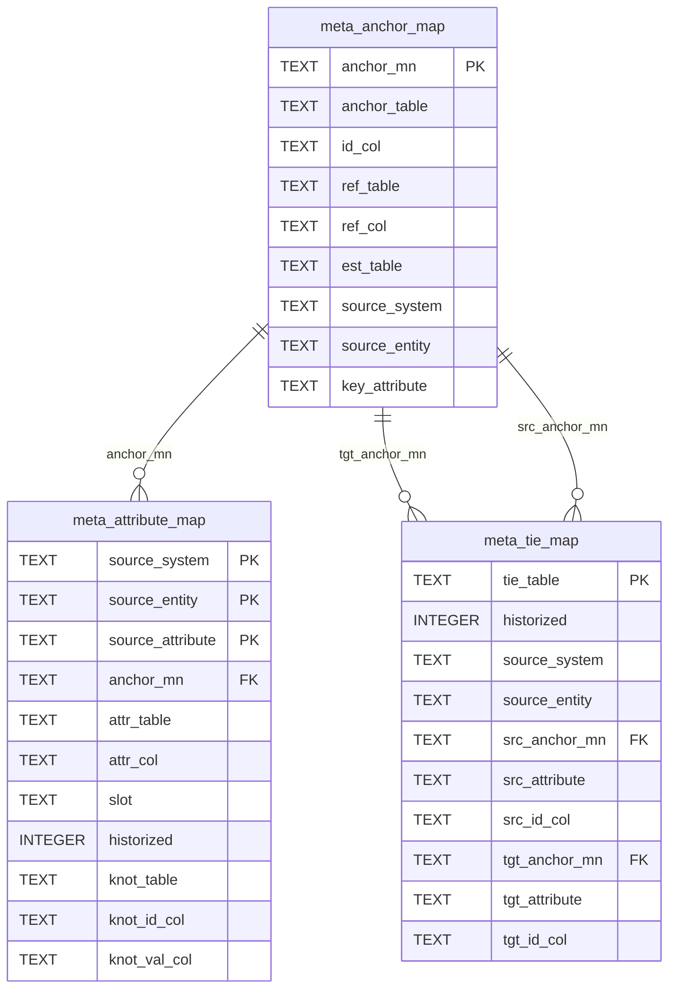
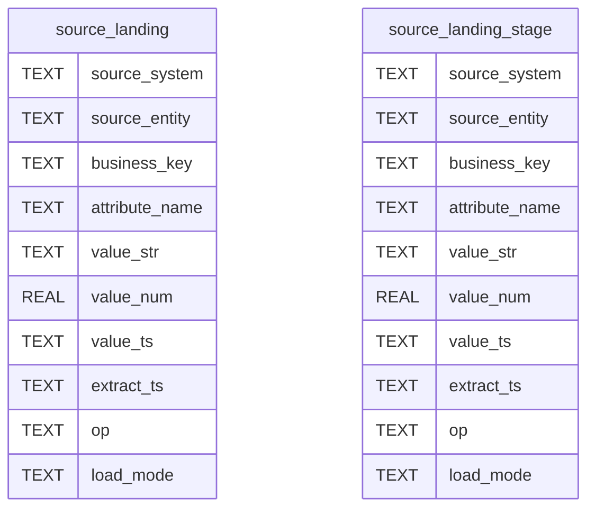
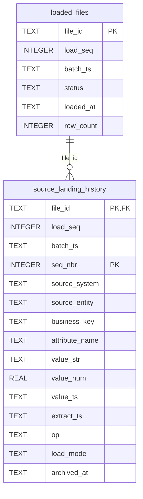

# Anchor Modeling — ER diagrams

Generated from [`v3_anchor/build/anchor.db`](../../v3_anchor/build/anchor.db) and `archive/anchor_archive.db` by `er-diagrams/generate.py`. Design notes: [`v3_anchor/ANCHOR.md`](../../v3_anchor/ANCHOR.md).

> `PK` is a primary-key column and `FK` a declared foreign key. A solid
> line is a declared foreign key; a dashed line is a join the model
> intends but does not declare. The crow's foot is the "many" side.

## 1 · Overview — keys only

All 24 tables of the constellation with their key columns: three anchors, their attributes, three knots and two ties.

```mermaid
erDiagram
    CUR_Currency {
        INTEGER CUR_ID PK
    }
    CU_Customer {
        INTEGER CU_ID PK
    }
    CU_EML_Customer_Email {
        INTEGER CU_ID PK, FK
        TEXT ChangedAt PK
    }
    CU_EST_Customer_Existence {
        INTEGER CU_ID PK, FK
        INTEGER EST_ID FK
        TEXT ChangedAt PK
    }
    CU_NAM_Customer_Name {
        INTEGER CU_ID PK, FK
        TEXT ChangedAt PK
    }
    CU_REF_Customer_Reference {
        INTEGER CU_ID PK, FK
    }
    CU_SGN_Customer_SignupDate {
        INTEGER CU_ID PK, FK
    }
    EST_ExistenceStatus {
        INTEGER EST_ID PK
    }
    OD_AMT_Order_Amount {
        INTEGER OD_ID PK, FK
        TEXT ChangedAt PK
    }
    OD_CUR_Order_Currency {
        INTEGER OD_ID PK, FK
        INTEGER CUR_ID FK
        TEXT ChangedAt PK
    }
    OD_EST_Order_Existence {
        INTEGER OD_ID PK, FK
        INTEGER EST_ID FK
        TEXT ChangedAt PK
    }
    OD_OST_Order_Status {
        INTEGER OD_ID PK, FK
        INTEGER OST_ID FK
        TEXT ChangedAt PK
    }
    OD_Order {
        INTEGER OD_ID PK
    }
    OD_PLC_Order_PlacedAt {
        INTEGER OD_ID PK, FK
    }
    OD_REF_Order_Reference {
        INTEGER OD_ID PK, FK
    }
    OD_part_PR_of {
        INTEGER OD_ID PK, FK
        INTEGER PR_ID PK, FK
    }
    OD_placed_CU_by {
        INTEGER OD_ID PK, FK
        INTEGER CU_ID FK
        TEXT ChangedAt PK
    }
    OST_OrderStatus {
        INTEGER OST_ID PK
    }
    PR_CUR_Product_Currency {
        INTEGER PR_ID PK, FK
        INTEGER CUR_ID FK
        TEXT ChangedAt PK
    }
    PR_EST_Product_Existence {
        INTEGER PR_ID PK, FK
        INTEGER EST_ID FK
        TEXT ChangedAt PK
    }
    PR_NAM_Product_Name {
        INTEGER PR_ID PK, FK
        TEXT ChangedAt PK
    }
    PR_PRC_Product_Price {
        INTEGER PR_ID PK, FK
        TEXT ChangedAt PK
    }
    PR_Product {
        INTEGER PR_ID PK
    }
    PR_REF_Product_Reference {
        INTEGER PR_ID PK, FK
    }
    CU_Customer ||--o{ CU_EML_Customer_Email : "CU_ID"
    EST_ExistenceStatus ||--o{ CU_EST_Customer_Existence : "EST_ID"
    CU_Customer ||--o{ CU_EST_Customer_Existence : "CU_ID"
    CU_Customer ||--o{ CU_NAM_Customer_Name : "CU_ID"
    CU_Customer ||--o| CU_REF_Customer_Reference : "CU_ID"
    CU_Customer ||--o| CU_SGN_Customer_SignupDate : "CU_ID"
    OD_Order ||--o{ OD_AMT_Order_Amount : "OD_ID"
    CUR_Currency ||--o{ OD_CUR_Order_Currency : "CUR_ID"
    OD_Order ||--o{ OD_CUR_Order_Currency : "OD_ID"
    EST_ExistenceStatus ||--o{ OD_EST_Order_Existence : "EST_ID"
    OD_Order ||--o{ OD_EST_Order_Existence : "OD_ID"
    OST_OrderStatus ||--o{ OD_OST_Order_Status : "OST_ID"
    OD_Order ||--o{ OD_OST_Order_Status : "OD_ID"
    OD_Order ||--o| OD_PLC_Order_PlacedAt : "OD_ID"
    OD_Order ||--o| OD_REF_Order_Reference : "OD_ID"
    PR_Product ||--o{ OD_part_PR_of : "PR_ID"
    OD_Order ||--o{ OD_part_PR_of : "OD_ID"
    CU_Customer ||--o{ OD_placed_CU_by : "CU_ID"
    OD_Order ||--o{ OD_placed_CU_by : "OD_ID"
    CUR_Currency ||--o{ PR_CUR_Product_Currency : "CUR_ID"
    PR_Product ||--o{ PR_CUR_Product_Currency : "PR_ID"
    EST_ExistenceStatus ||--o{ PR_EST_Product_Existence : "EST_ID"
    PR_Product ||--o{ PR_EST_Product_Existence : "PR_ID"
    PR_Product ||--o{ PR_NAM_Product_Name : "PR_ID"
    PR_Product ||--o{ PR_PRC_Product_Price : "PR_ID"
    PR_Product ||--o| PR_REF_Product_Reference : "PR_ID"
```

## 2 · Customer anchor

One table per attribute. Presence is the existence attribute, which points at a knot.

## 3 · Product anchor

## 4 · Order anchor and ties

The two ties relate an order to its customer and to its products. Customer and product show their keys only.

```mermaid
erDiagram
    OD_AMT_Order_Amount {
        INTEGER OD_ID PK, FK
        REAL Order_Amount
        TEXT ChangedAt PK
        TEXT Metadata_LDTS
    }
    OD_CUR_Order_Currency {
        INTEGER OD_ID PK, FK
        INTEGER CUR_ID FK
        TEXT ChangedAt PK
        TEXT Metadata_LDTS
    }
    OD_EST_Order_Existence {
        INTEGER OD_ID PK, FK
        INTEGER EST_ID FK
        TEXT ChangedAt PK
        TEXT Metadata_LDTS
    }
    OD_OST_Order_Status {
        INTEGER OD_ID PK, FK
        INTEGER OST_ID FK
        TEXT ChangedAt PK
        TEXT Metadata_LDTS
    }
    OD_Order {
        INTEGER OD_ID PK
        TEXT Metadata_LDTS
    }
    OD_PLC_Order_PlacedAt {
        INTEGER OD_ID PK, FK
        TEXT Order_PlacedAt
        TEXT Metadata_LDTS
    }
    OD_REF_Order_Reference {
        INTEGER OD_ID PK, FK
        TEXT Order_Reference
        TEXT Metadata_LDTS
    }
    OD_part_PR_of {
        INTEGER OD_ID PK, FK
        INTEGER PR_ID PK, FK
        TEXT Metadata_LDTS
    }
    OD_placed_CU_by {
        INTEGER OD_ID PK, FK
        INTEGER CU_ID FK
        TEXT ChangedAt PK
        TEXT Metadata_LDTS
    }
    EST_ExistenceStatus {
        INTEGER EST_ID PK
        TEXT ExistenceStatus
    }
    OST_OrderStatus {
        INTEGER OST_ID PK
        TEXT Status_Code
        TEXT Order_Status
    }
    CUR_Currency {
        INTEGER CUR_ID PK
        TEXT Currency
    }
    CU_Customer {
        INTEGER CU_ID PK
    }
    PR_Product {
        INTEGER PR_ID PK
    }
    OD_Order ||--o{ OD_AMT_Order_Amount : "OD_ID"
    CUR_Currency ||--o{ OD_CUR_Order_Currency : "CUR_ID"
    OD_Order ||--o{ OD_CUR_Order_Currency : "OD_ID"
    EST_ExistenceStatus ||--o{ OD_EST_Order_Existence : "EST_ID"
    OD_Order ||--o{ OD_EST_Order_Existence : "OD_ID"
    OST_OrderStatus ||--o{ OD_OST_Order_Status : "OST_ID"
    OD_Order ||--o{ OD_OST_Order_Status : "OD_ID"
    OD_Order ||--o| OD_PLC_Order_PlacedAt : "OD_ID"
    OD_Order ||--o| OD_REF_Order_Reference : "OD_ID"
    PR_Product ||--o{ OD_part_PR_of : "PR_ID"
    OD_Order ||--o{ OD_part_PR_of : "OD_ID"
    CU_Customer ||--o{ OD_placed_CU_by : "CU_ID"
    OD_Order ||--o{ OD_placed_CU_by : "OD_ID"
```

## 5 · Metadata and load control

Registries, routing maps and the parameters the loaders read.

## 6 · Staging

Where a delivery lands before it is applied. Staging tables hold source names, so they have no relationships.

## 7 · Raw layer (archive)

The durable raw layer, in its own database file. Every delivery is captured here verbatim before it is applied, and the tables are append-only.

