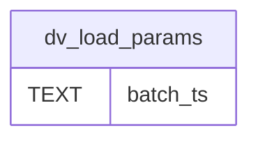
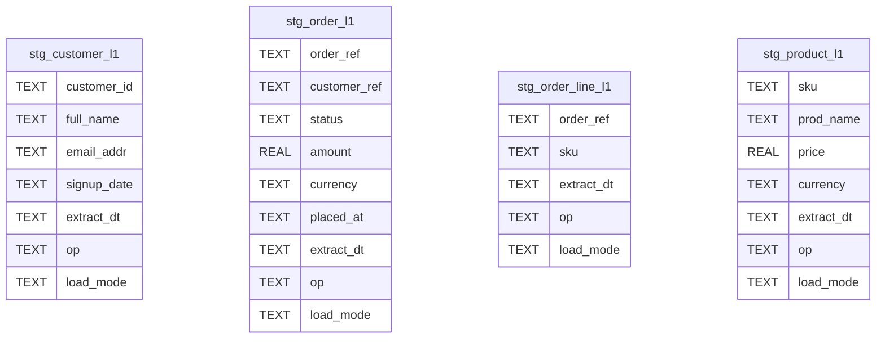
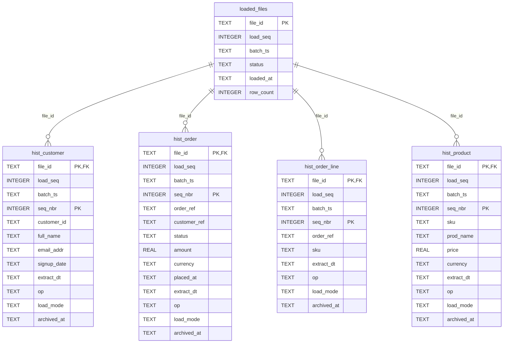

# Data Vault 2.0 — ER diagrams

Generated from [`v3_datavault/build/datavault.db`](../../v3_datavault/build/datavault.db) and `archive/datavault_archive.db` by `er-diagrams/generate.py`. Design notes: [`v3_datavault/DATAVAULT.md`](../../v3_datavault/DATAVAULT.md).

> `PK` is a primary-key column and `FK` a declared foreign key. A solid
> line is a declared foreign key; a dashed line is a join the model
> intends but does not declare. The crow's foot is the "many" side.

This model declares only some of its relationships as foreign keys, so 3 dashed lines were added by hand in the generator.

## 1 · Core model

Hubs (`_h`), links (`_l`), satellites (`_hsat`), status satellites (`_sts`), a reference table, one effectivity satellite, the generated point-in-time (`_cpit`) and bridge tables, and the computed satellite `bv_order_status_bsat`, a view that decodes each order status with the newest reference label.

```mermaid
erDiagram
    bv_customer_cpit {
        TEXT customer_bk PK, FK
        TEXT hsat_bk FK
        TEXT hsat_ldts FK
        TEXT sts_bk FK
        TEXT sts_ldts FK
    }
    bv_order_bridge {
        TEXT order_bk PK, FK
        TEXT product_bk PK, FK
        TEXT customer_bk FK
    }
    bv_order_cpit {
        TEXT order_bk PK, FK
        TEXT hsat_bk FK
        TEXT hsat_ldts FK
        TEXT sts_bk FK
        TEXT sts_ldts FK
        TEXT eff_customer_bk
        TEXT eff_ldts
    }
    bv_order_customer_l_effsat {
        TEXT order_bk PK, FK
        TEXT customer_bk PK, FK
        TEXT ldts PK
        TEXT rsrc
        TEXT start_date
        TEXT old_customer_bk
    }
    bv_product_cpit {
        TEXT product_bk PK, FK
        TEXT hsat_bk FK
        TEXT hsat_ldts FK
        TEXT sts_bk FK
        TEXT sts_ldts FK
    }
    ref_order_status {
        TEXT code PK
        TEXT label
        TEXT ldts PK
        TEXT rsrc
    }
    rv_customer_h {
        TEXT customer_bk PK
        TEXT ldts
        TEXT rsrc
    }
    rv_customer_hsat {
        TEXT customer_bk PK, FK
        TEXT ldts PK
        TEXT rsrc
        TEXT diff_str
        TEXT full_name
        TEXT email_addr
        TEXT signup_date
    }
    rv_customer_sts {
        TEXT customer_bk PK, FK
        TEXT ldts PK
        TEXT rsrc
        TEXT sts
    }
    rv_order_customer_l {
        TEXT order_bk PK, FK
        TEXT customer_bk PK, FK
        TEXT ldts
        TEXT rsrc
    }
    rv_order_h {
        TEXT order_bk PK
        TEXT ldts
        TEXT rsrc
    }
    rv_order_hsat {
        TEXT order_bk PK, FK
        TEXT ldts PK
        TEXT rsrc
        TEXT diff_str
        TEXT status
        REAL amount
        TEXT currency
        TEXT placed_at
    }
    rv_order_product_l {
        TEXT order_bk PK, FK
        TEXT product_bk PK, FK
        TEXT ldts
        TEXT rsrc
    }
    rv_order_sts {
        TEXT order_bk PK, FK
        TEXT ldts PK
        TEXT rsrc
        TEXT sts
    }
    rv_product_h {
        TEXT product_bk PK
        TEXT ldts
        TEXT rsrc
    }
    rv_product_hsat {
        TEXT product_bk PK, FK
        TEXT ldts PK
        TEXT rsrc
        TEXT diff_str
        TEXT prod_name
        REAL price
        TEXT currency
    }
    rv_product_sts {
        TEXT product_bk PK, FK
        TEXT ldts PK
        TEXT rsrc
        TEXT sts
    }
    bv_order_status_bsat {
        TEXT order_bk
        TEXT ldts
        TEXT rsrc
        TEXT status
        untyped status_label
    }
    rv_customer_sts ||--o{ bv_customer_cpit : "sts_bk, sts_ldts"
    rv_customer_hsat ||--o{ bv_customer_cpit : "hsat_bk, hsat_ldts"
    rv_customer_h ||--o| bv_customer_cpit : "customer_bk"
    rv_customer_h ||--o{ bv_order_bridge : "customer_bk"
    rv_order_product_l ||--o| bv_order_bridge : "order_bk, product_bk"
    rv_order_sts ||--o{ bv_order_cpit : "sts_bk, sts_ldts"
    rv_order_hsat ||--o{ bv_order_cpit : "hsat_bk, hsat_ldts"
    rv_order_h ||--o| bv_order_cpit : "order_bk"
    rv_order_customer_l ||--o{ bv_order_customer_l_effsat : "order_bk, customer_bk"
    rv_product_sts ||--o{ bv_product_cpit : "sts_bk, sts_ldts"
    rv_product_hsat ||--o{ bv_product_cpit : "hsat_bk, hsat_ldts"
    rv_product_h ||--o| bv_product_cpit : "product_bk"
    rv_customer_h ||--o{ rv_customer_hsat : "customer_bk"
    rv_customer_h ||--o{ rv_customer_sts : "customer_bk"
    rv_customer_h ||--o{ rv_order_customer_l : "customer_bk"
    rv_order_h ||--o{ rv_order_customer_l : "order_bk"
    rv_order_h ||--o{ rv_order_hsat : "order_bk"
    rv_product_h ||--o{ rv_order_product_l : "product_bk"
    rv_order_h ||--o{ rv_order_product_l : "order_bk"
    rv_order_h ||--o{ rv_order_sts : "order_bk"
    rv_product_h ||--o{ rv_product_hsat : "product_bk"
    rv_product_h ||--o{ rv_product_sts : "product_bk"
    ref_order_status ||..o{ rv_order_hsat : "status = code"
    ref_order_status ||..o{ bv_order_status_bsat : "status = code"
    rv_order_hsat ||..o{ bv_order_status_bsat : "order_bk, ldts"
```

## 2 · Metadata and load control

Registries, routing maps and the parameters the loaders read.

## 3 · Staging

Where a delivery lands before it is applied. Staging tables hold source names, so they have no relationships.

## 4 · Raw layer (archive)

The durable raw layer, in its own database file. Every delivery is captured here verbatim before it is applied, and the tables are append-only.

