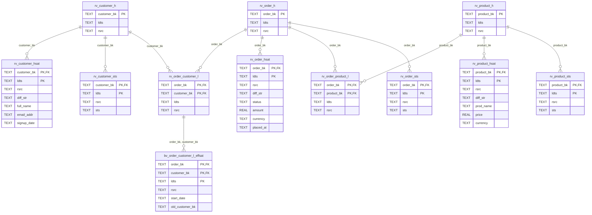
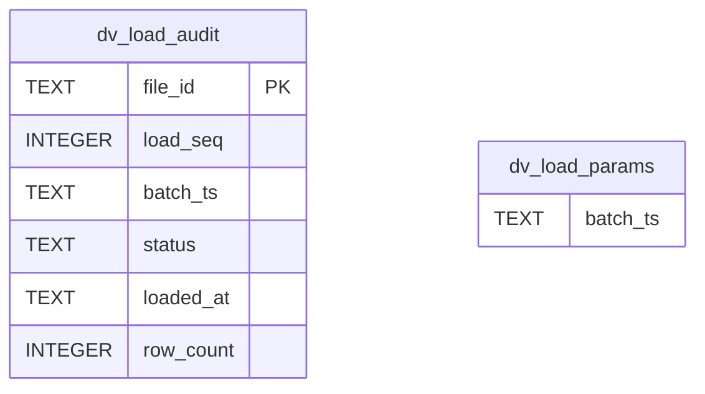
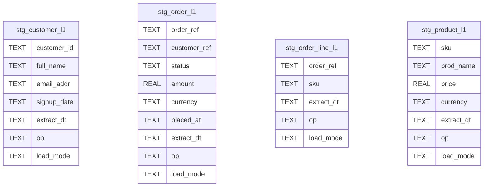

# Data Vault 2.0 — ER diagrams

Generated from [`v3_datavault/build/datavault.db`](../../v3_datavault/build/datavault.db) by `er-diagrams/generate.py`. Design notes: [`v3_datavault/DATAVAULT.md`](../../v3_datavault/DATAVAULT.md).

> `PK` is a primary-key column and `FK` a declared foreign key. A solid
> line is a declared foreign key; a dashed line is a join the model
> intends but does not declare. The crow's foot is the "many" side.

## 1 · Core model

Hubs (`_h`), links (`_l`), satellites (`_hsat`), status satellites (`_sts`) and one effectivity satellite. The insert-only raw vault is its own durable layer, so there is no archive database.

## 2 · Metadata and load control

Registries, routing maps and the parameters the loaders read.

## 3 · Staging

Where a delivery lands before it is applied. Staging tables hold source names, so they have no relationships.

