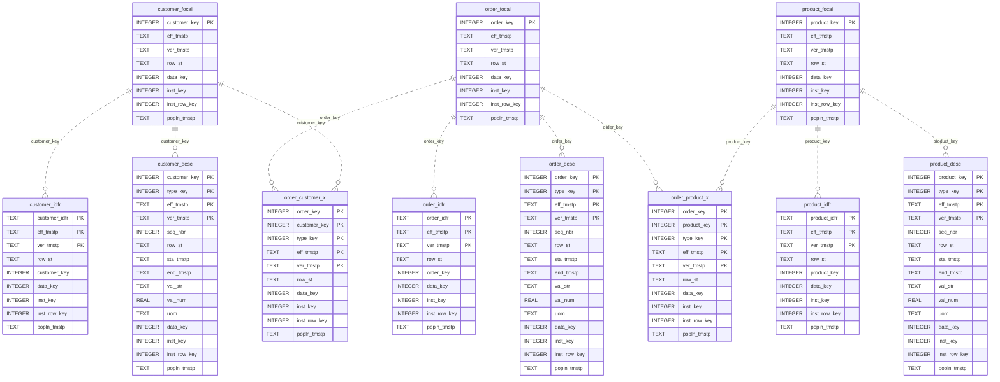
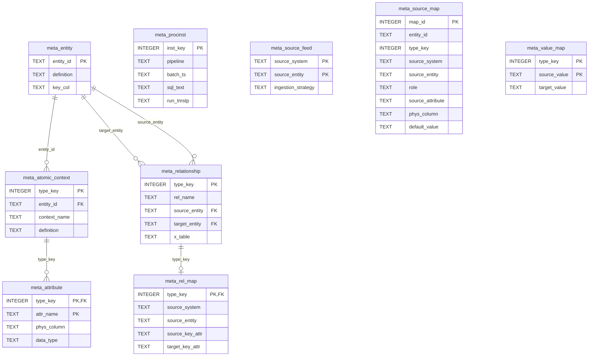
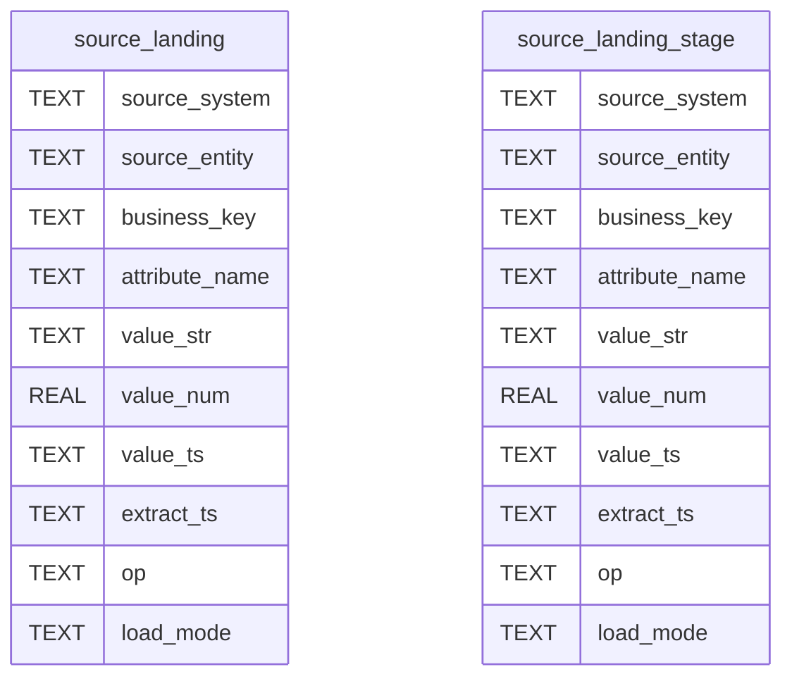
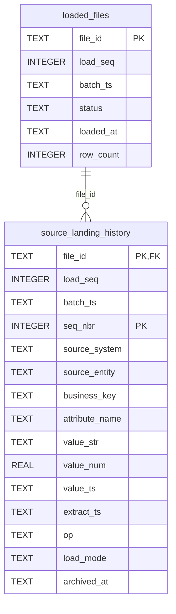

# Focal Point — ER diagrams

Generated from [`v3_focal-point/build/focal.db`](../../v3_focal-point/build/focal.db) and `archive/focal_archive.db` by `er-diagrams/generate.py`. Design notes: [`v3_focal-point/FOCALPOINT.md`](../../v3_focal-point/FOCALPOINT.md).

> `PK` is a primary-key column and `FK` a declared foreign key. A solid
> line is a declared foreign key; a dashed line is a join the model
> intends but does not declare. The crow's foot is the "many" side.

This model declares none of its relationships as foreign keys, so 10 dashed lines were added by hand in the generator.

## 1 · Core model

Three generic tables per entity (`_idfr`, `_focal`, `_desc`) and one `_x` table per relationship. The core declares no foreign keys; `type_key` values are defined in the metadata.

## 2 · Metadata and load control

Registries, routing maps and the parameters the loaders read.

## 3 · Staging

Where a delivery lands before it is applied. Staging tables hold source names, so they have no relationships.

## 4 · Raw layer (archive)

The durable raw layer, in its own database file. Every delivery is captured here verbatim before it is applied, and the tables are append-only.

