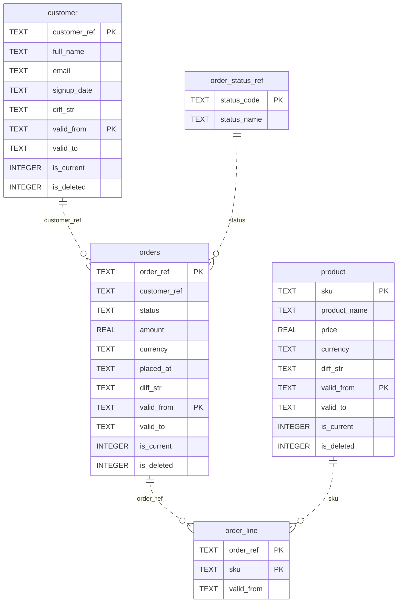
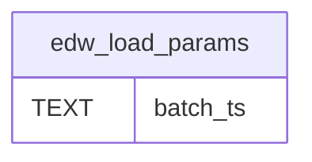
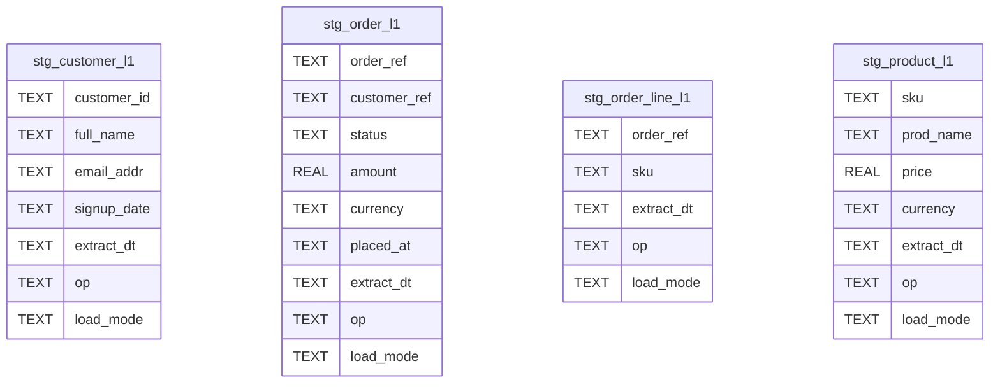
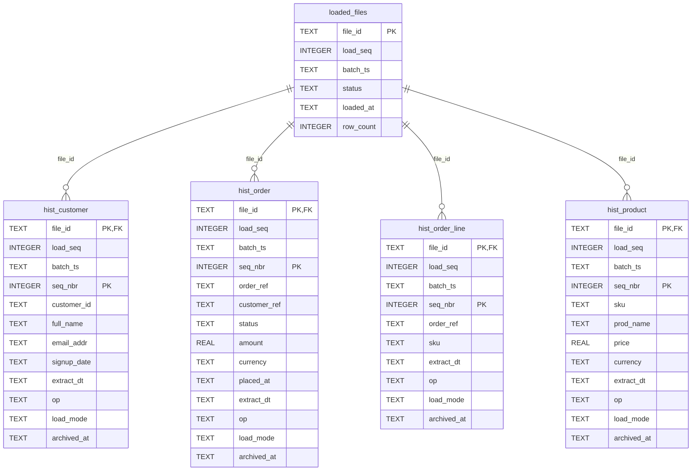

# Inmon 3NF EDW — ER diagrams

Generated from [`v3_inmon-3nf/build/edw.db`](../../v3_inmon-3nf/build/edw.db) and `archive/edw_archive.db` by `er-diagrams/generate.py`. Design notes: [`v3_inmon-3nf/INMON.md`](../../v3_inmon-3nf/INMON.md).

> `PK` is a primary-key column and `FK` a declared foreign key. A solid
> line is a declared foreign key; a dashed line is a join the model
> intends but does not declare. The crow's foot is the "many" side.

This model declares none of its relationships as foreign keys, so 4 dashed lines were added by hand in the generator.

## 1 · Core model

Time-variant entities keyed on the natural key plus `valid_from`. The model declares no foreign keys, because a reference is to an entity and not to one of its versions.

## 2 · Metadata and load control

Registries, routing maps and the parameters the loaders read.

## 3 · Staging

Where a delivery lands before it is applied. Staging tables hold source names, so they have no relationships.

## 4 · Raw layer (archive)

The durable raw layer, in its own database file. Every delivery is captured here verbatim before it is applied, and the tables are append-only.

