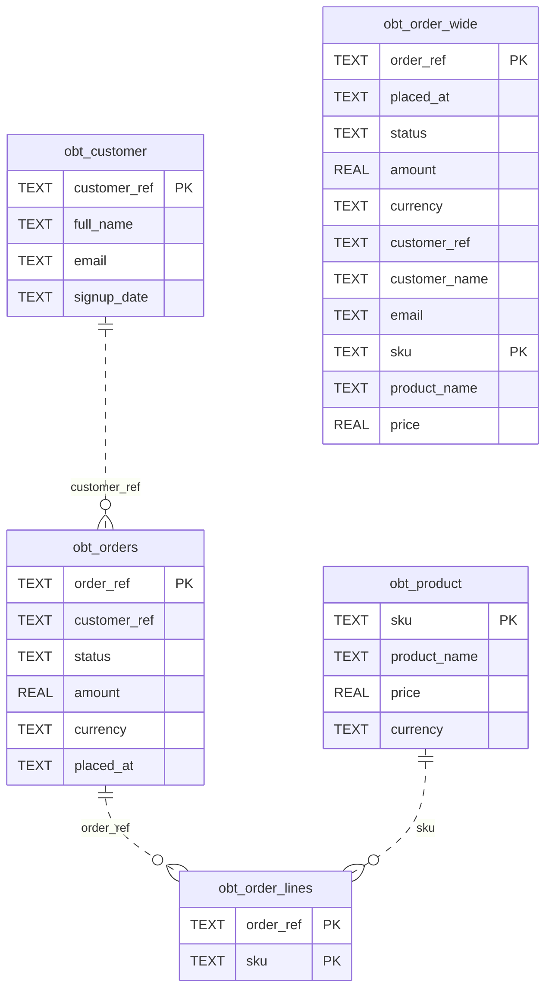
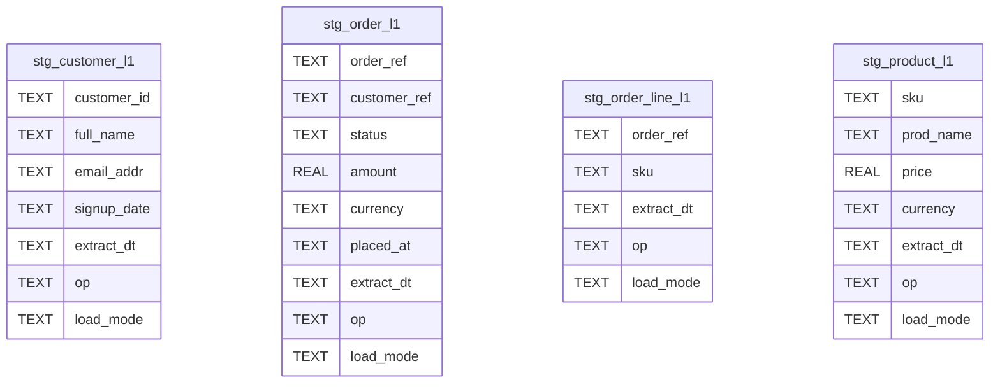
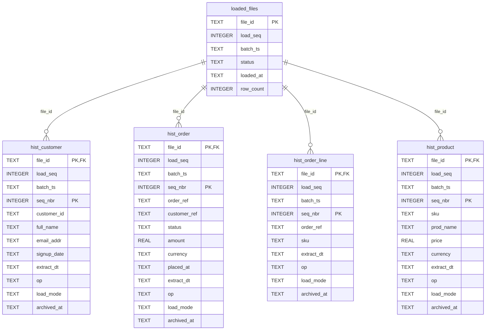

# One Big Table — ER diagrams

Generated from [`v3_one-big-table/build/obt.db`](../../v3_one-big-table/build/obt.db) and `archive/obt_archive.db` by `er-diagrams/generate.py`. Design notes: [`v3_one-big-table/OBT.md`](../../v3_one-big-table/OBT.md).

> `PK` is a primary-key column and `FK` a declared foreign key. A solid
> line is a declared foreign key; a dashed line is a join the model
> intends but does not declare. The crow's foot is the "many" side.

This model declares none of its relationships as foreign keys, so 3 dashed lines were added by hand in the generator.

## 1 · Core model

Full-refresh tables recomputed from the log. `obt_order_wide` is the one big table; it repeats the others' columns and joins to nothing.

## 2 · Staging

Where a delivery lands before it is applied. Staging tables hold source names, so they have no relationships.

## 3 · Raw layer (archive)

The durable raw layer, in its own database file. Every delivery is captured here verbatim before it is applied, and the tables are append-only.

