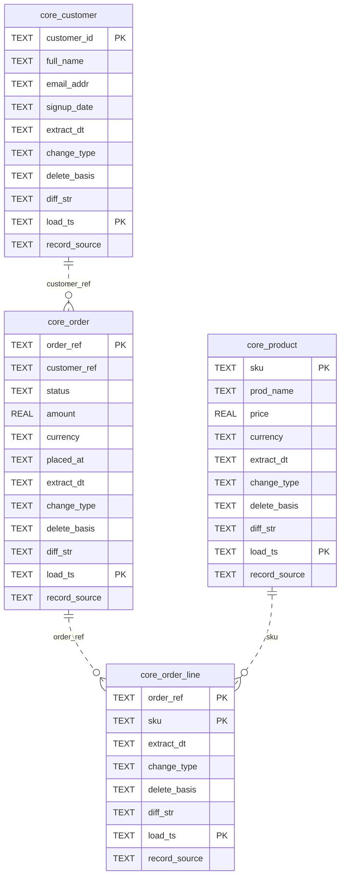
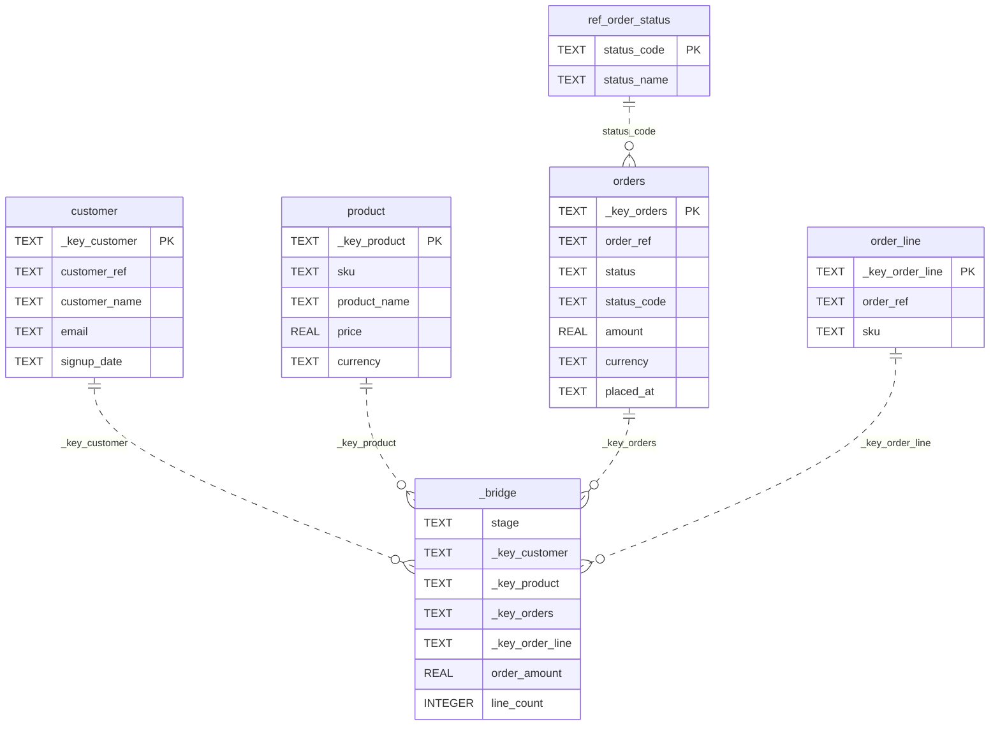
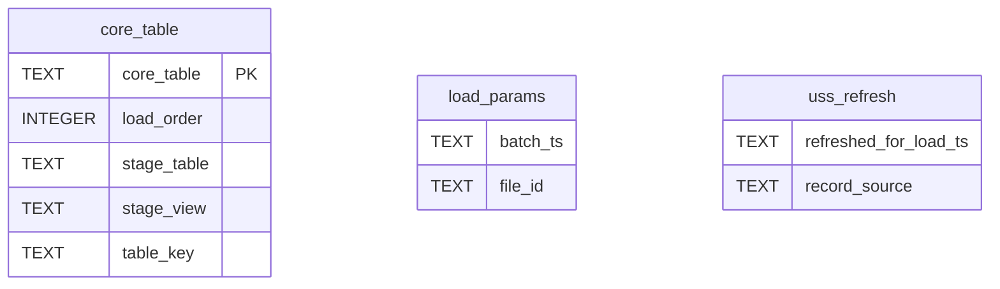
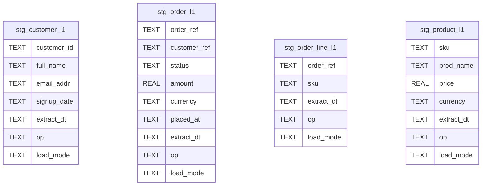
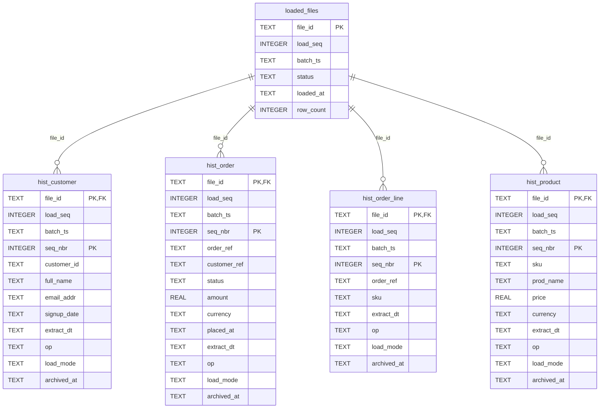

# Unified Star Schema — ER diagrams

Generated from [`v3_unified-star-schema/build/uss.db`](../../v3_unified-star-schema/build/uss.db) and `archive/uss_archive.db` by `er-diagrams/generate.py`. Design notes: [`v3_unified-star-schema/USS.md`](../../v3_unified-star-schema/USS.md).

> `PK` is a primary-key column and `FK` a declared foreign key. A solid
> line is a declared foreign key; a dashed line is a join the model
> intends but does not declare. The crow's foot is the "many" side.

This model declares none of its relationships as foreign keys, so 8 dashed lines were added by hand in the generator.

## 1 · Insert-only core

History lives here. The Unified Star Schema is a presentation model, so this demo puts it on a core of its own.

## 2 · Unified Star Schema (presentation layer)

Re-derived from the core after every delivery. Every table joins only to the bridge, through its own `_key_` column.

## 3 · Metadata and load control

Registries, routing maps and the parameters the loaders read.

## 4 · Staging

Where a delivery lands before it is applied. Staging tables hold source names, so they have no relationships.

## 5 · Raw layer (archive)

The durable raw layer, in its own database file. Every delivery is captured here verbatim before it is applied, and the tables are append-only.

