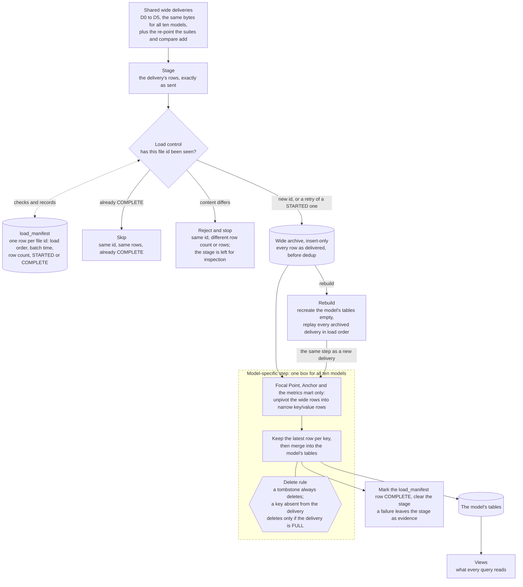

# Build: how a delivery becomes a warehouse

Level 1, conceptual. One delivery's path through any of the ten models,
and the rebuild that replays the archive through the same step. The ten
models differ only inside the dashed box. See the
[README](../README.md) for how to read it.

