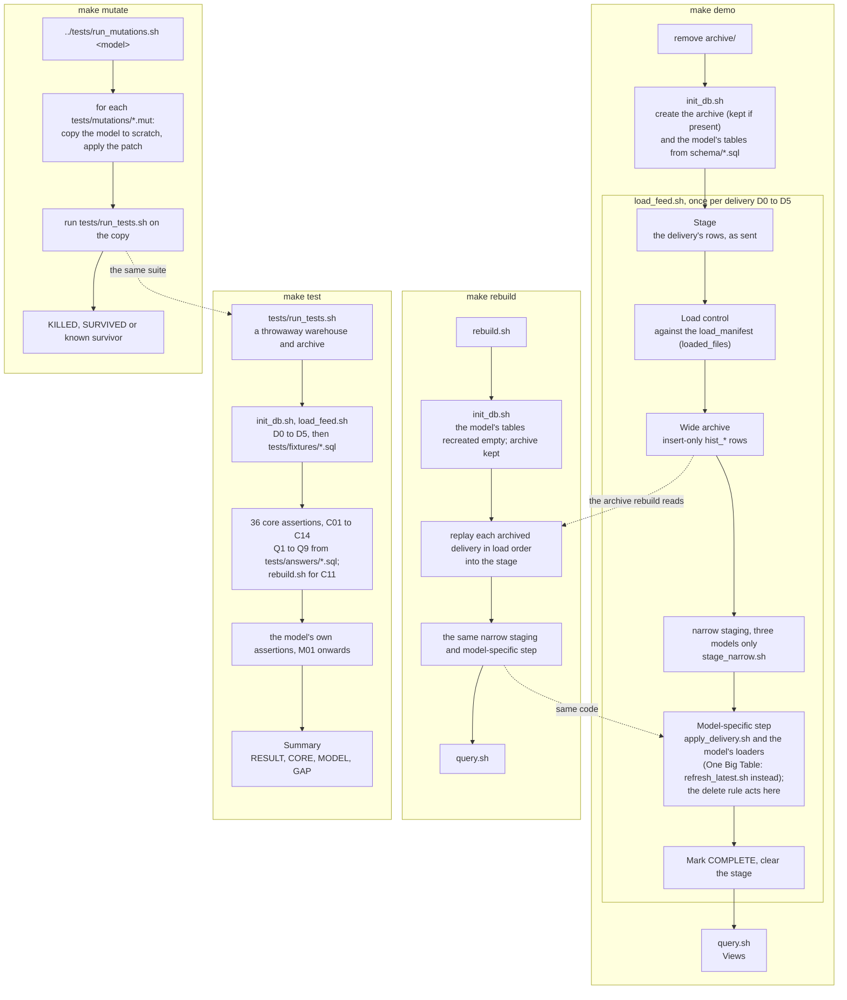

# Model pipeline: one model's make targets, traced

Level 2, traced. One generic model: what `make demo`, `make rebuild`,
`make test` and `make mutate` run, using the stage names of
[build.md](build.md) and [prove.md](prove.md). The table below names the
file that does each step in each of the ten models. Found by
`tools/trace_flows.sh` (`--confirm` checks a model's tree against a
traced real run); `make trace-check` fails if a script or schema file a
target runs is missing from that model's column. See the
[README](../README.md) for how to read it.

## Who does each step

One row per generic step, one column per model. A dash means the model
has no such step.

| Step | inmon-3nf | data-marts | datavault | focal-point | anchor | hook | unified-star-schema | activity-schema | metrics-mart | one-big-table |
|---|---|---|---|---|---|---|---|---|---|---|
| Shared helpers, sourced by every script | lib.sh | lib.sh | lib.sh | lib.sh | lib.sh | lib.sh | lib.sh | lib.sh | lib.sh | lib.sh |
| Create the archive and the model's tables (`make init`, demo, rebuild) | init_db.sh: 02_archive.sql, 01_stage.sql, 03_edw.sql | init_db.sh: 02_archive.sql, 01_stage.sql, 03_dimensions.sql, 04_facts.sql | init_db.sh: 02_archive.sql, 01_stage.sql, 02_stage2_views.sql, 03_raw_vault.sql, 04_business_vault.sql, 05_info_mart.sql | init_db.sh: 05_archive.sql, 01_metadata.sql, 02_data.sql, 03_seed_metadata.sql, 04_views.sql | init_db.sh: 02_archive.sql, 01_landing.sql, 03_anchor.sql, 04_views.sql | init_db.sh: 02_archive.sql, 01_stage.sql, 03_hook.sql, 04_views.sql | init_db.sh: 02_archive.sql, 01_stage.sql, 03_core.sql, 04_uss.sql | init_db.sh: 02_archive.sql, 01_stage.sql, 03_activity.sql, 04_views.sql | init_db.sh: 02_archive.sql, 01_landing.sql, 03_mart.sql, 04_seed.sql, 05_views.sql | init_db.sh: 02_archive.sql, 01_stage.sql |
| Stage the delivery | load_feed.sh into 01_stage.sql tables | load_feed.sh into 01_stage.sql tables | load_feed.sh into 01_stage.sql tables | load_feed.sh into 01_metadata.sql tables | load_feed.sh into 01_landing.sql tables | load_feed.sh into 01_stage.sql tables | load_feed.sh into 01_stage.sql tables | load_feed.sh into 01_stage.sql tables | load_feed.sh into 01_landing.sql tables | load_feed.sh into 01_stage.sql tables |
| Load control and the load_manifest (`loaded_files`) | load_feed.sh; 02_archive.sql | load_feed.sh; 02_archive.sql | load_feed.sh; 02_archive.sql | load_feed.sh; 05_archive.sql | load_feed.sh; 02_archive.sql | load_feed.sh; 02_archive.sql | load_feed.sh; 02_archive.sql | load_feed.sh; 02_archive.sql | load_feed.sh; 02_archive.sql | load_feed.sh; 02_archive.sql |
| Wide archive, insert-only (`hist_*`) | load_feed.sh; 02_archive.sql | load_feed.sh; 02_archive.sql | load_feed.sh; 02_archive.sql | load_feed.sh; 05_archive.sql | load_feed.sh; 02_archive.sql | load_feed.sh; 02_archive.sql | load_feed.sh; 02_archive.sql | load_feed.sh; 02_archive.sql | load_feed.sh; 02_archive.sql | load_feed.sh; 02_archive.sql |
| Narrow staging: wide rows to key/value rows | — | — | — | stage_narrow.sh | stage_narrow.sh | — | — | — | stage_narrow.sh | — |
| Model-specific step | apply_delivery.sh → load_edw.sh | apply_delivery.sh → load_dims.sh, load_facts.sh | apply_delivery.sh → load_hubs.sh, load_sats.sh, load_links.sh | apply_delivery.sh → load_keys.sh, load_desc.sh, load_rel.sh | apply_delivery.sh → load_anchors.sh, load_attributes.sh, load_ties.sh | apply_delivery.sh → load_frames.sh | apply_delivery.sh → load_core.sh | apply_delivery.sh → load_activities.sh | apply_delivery.sh → route_stage.sh, load_res.sh, load_groups.sh, load_metrics.sh | no apply_delivery.sh: load_feed.sh → refresh_latest.sh, a full refresh over the log |
| Model-only step after the load | — | — | business vault: the 04_business_vault.sql views, and refresh_query_assist.sh rewrites its bv_ query-assist tables | — | — | — | the bridge: refresh_uss.sh (also `make refresh`) | — | aggregates: refresh_aggregates.sh | — |
| Delete rule (a FULL delivery's absences) applied in | load_edw.sh | load_dims.sh | load_sats.sh | load_desc.sh, load_rel.sh | load_attributes.sh | load_frames.sh | load_core.sh | load_activities.sh | route_stage.sh, load_groups.sh | refresh_latest.sh |
| Views (`make demo` and `make rebuild` print them) | query.sh | query.sh | query.sh | query.sh | query.sh | query.sh | query.sh | query.sh | query.sh | query.sh reads 03_log_views.sql (temporary views over the log) |
| Rebuild from the archive | rebuild.sh | rebuild.sh | rebuild.sh | rebuild.sh, stage_narrow.sh | rebuild.sh, stage_narrow.sh | rebuild.sh | rebuild.sh | rebuild.sh | rebuild.sh, stage_narrow.sh | rebuild.sh → refresh_latest.sh |
| Suite (`make test`) | run_tests.sh | run_tests.sh | run_tests.sh, which also runs `make rebuild` | run_tests.sh, which also runs `make rebuild` and archive_status.sh | run_tests.sh, which also runs `make rebuild` | run_tests.sh | run_tests.sh | run_tests.sh | run_tests.sh, which also runs `make rebuild` | run_tests.sh, which reads 03_log_views.sql |
| Mutations (`make mutate`, via ../tests/run_mutations.sh) | 23 in tests/mutations/ | 26 | 25 | 24 | 23 | 26 | 26 | 25 | 41 | 22 |
| Other targets | — | `make archive-status`: archive_status.sh | — | `make archive-status`: archive_status.sh | — | — | `make refresh`: refresh_uss.sh | — | — | — |

Every model also has `make clean` (removes `build/`), `make clean-archive`
(removes `archive/`) and `make help`, which run no script. Every suite
reads its nine answers from `tests/answers/Q1.sql` to `Q9.sql` and its
extra deliveries from `tests/fixtures/`.
