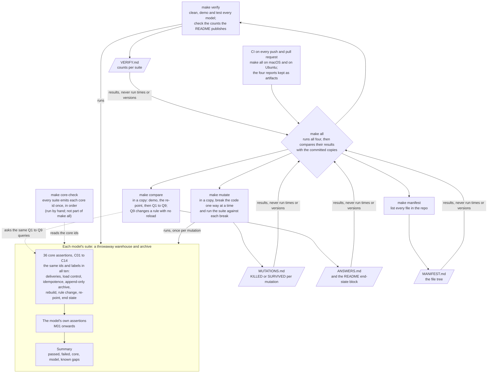

# Prove: how the repo checks its own claims

Level 1, conceptual. What each suite asserts, the three repo-wide runs
built on the suites, the manifest of every file, the reports they write, and how `make all` and CI
turn those reports into a pass or a fail. See the
[README](../README.md) for how to read it.

