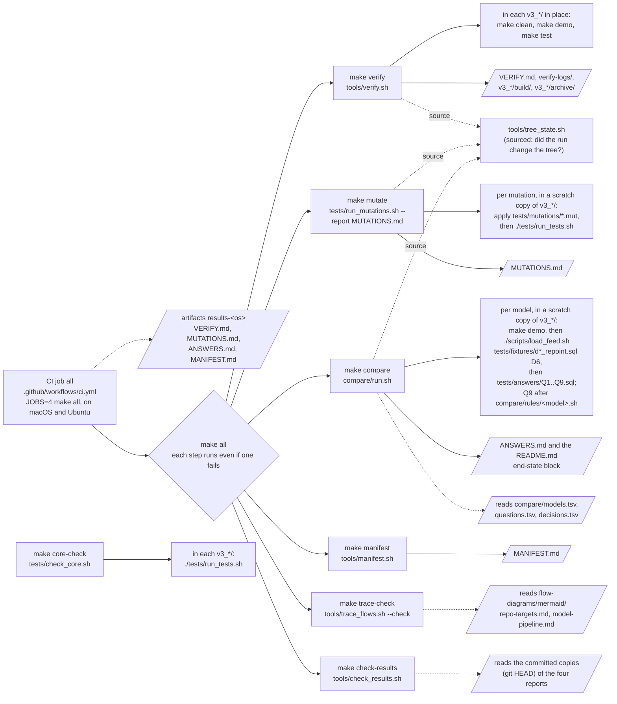

# Repo targets: the root Makefile and CI, traced

Level 2, traced. Every root `make` target and the CI job, down to the
`make` calls each one makes into the `v3_*` directories and the files it
writes. Found by `tools/trace_flows.sh`, which prints the same graph as
indented trees; `make trace-check` fails if a script a target runs is
missing here or from [model-pipeline.md](model-pipeline.md). See the
[README](../README.md) for how to read it.

Each box inside a `v3_*` directory is drawn once for all ten: the
model's own tree is in [model-pipeline.md](model-pipeline.md).
`make core-check` is run by hand; `make all` does not run it. No root
target runs `flow-diagrams/render.sh` or `er-diagrams/generate.py`.
