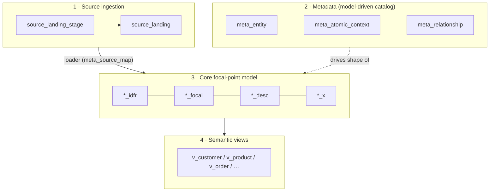
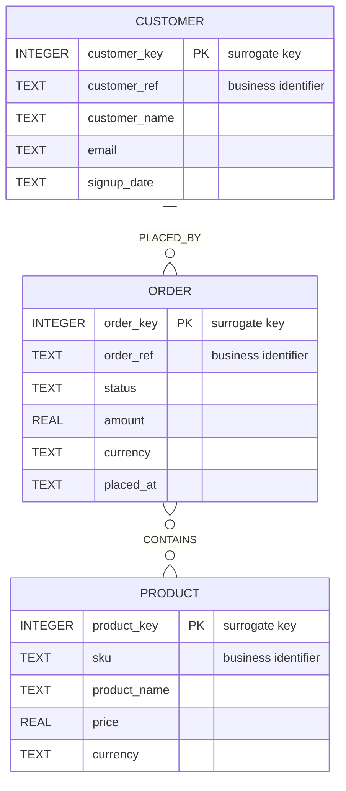
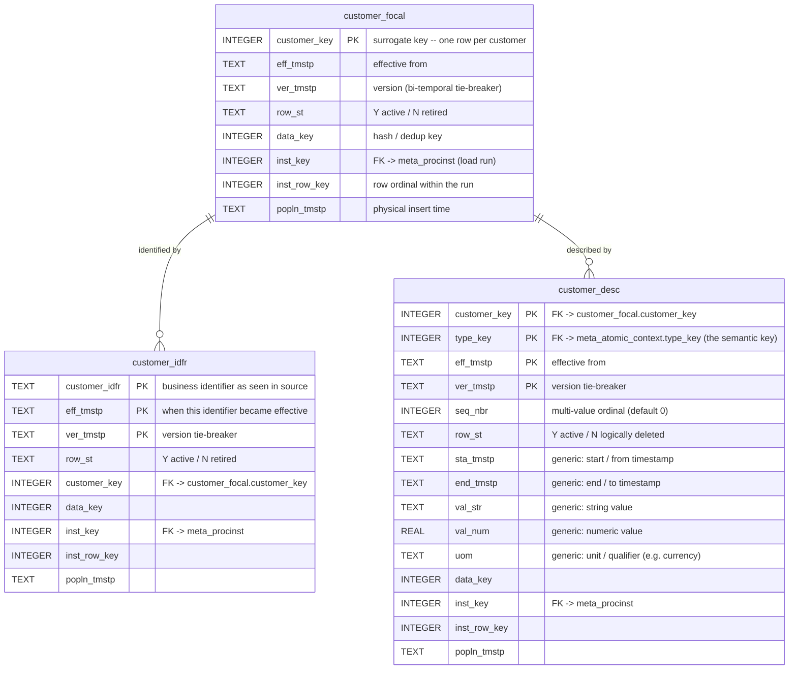
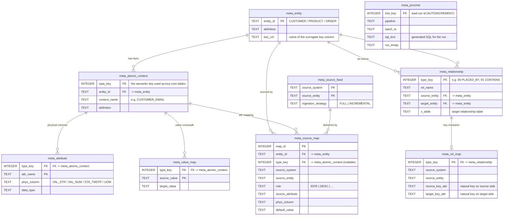
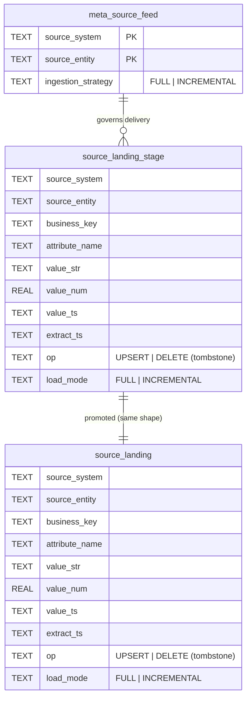
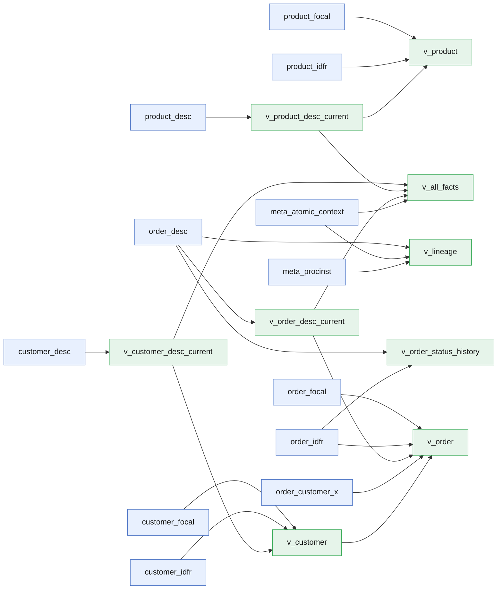

# `focal.db` — Entity-Relationship Diagrams

ER diagrams for the warehouse in [`build/focal.db`](../build/focal.db), generated from
the live schema. The database implements a **focal-point** (anchor-modeling / Data-Vault
style) model, so it is easier to read as a set of diagrams — one per architectural layer —
than as a single graph.

> **Reading the cardinalities.** Only the `meta_*` tables carry declared `FOREIGN KEY`s.
> All relationships in the *core* and *source* layers are **logical** — they are joins on
> surrogate keys (`*_key`) and semantic keys (`type_key`), not enforced constraints. They are
> drawn here to show intent. Columns marked `PK` are part of the SQLite primary key; `FK`
> marks a logical or declared foreign reference (noted in the column comment).

## Layers at a glance

---

## 1 · Conceptual (business) model

What the warehouse actually *means*, independent of the physical pattern. Derived from
`meta_entity`, `meta_relationship`, and the `v_*` views.

- **PLACED_BY** — each order is placed by exactly one customer; a customer may place many
  orders. (`meta_relationship.type_key = 90`, resolved through `order_customer_x`.)
- **CONTAINS** — an order contains many products and a product appears on many orders.
  (`meta_relationship.type_key = 91`, resolved through `order_product_x`.)

---

## 2a · Core focal-point model — overview

Every business entity is stored as a **triad** of tables plus optional **`_x`** relationship
tables. Key columns only, so the overall shape is visible.

```mermaid
erDiagram
    customer_focal ||--o{ customer_idfr : "identified by"
    customer_focal ||--o{ customer_desc : "described by"
    product_focal  ||--o{ product_idfr  : "identified by"
    product_focal  ||--o{ product_desc  : "described by"
    order_focal    ||--o{ order_idfr    : "identified by"
    order_focal    ||--o{ order_desc    : "described by"

    order_focal    ||--o{ order_customer_x : "PLACED_BY"
    customer_focal ||--o{ order_customer_x : "places"
    order_focal    ||--o{ order_product_x  : "CONTAINS"
    product_focal  ||--o{ order_product_x  : "line item"

    customer_focal {
        INTEGER customer_key PK
    }
    customer_idfr {
        TEXT    customer_idfr PK "natural key"
        TEXT    eff_tmstp     PK
        TEXT    ver_tmstp     PK
        INTEGER customer_key  FK "-> customer_focal"
        TEXT    row_st           "Y active / N retired"
    }
    customer_desc {
        INTEGER customer_key PK "FK -> customer_focal"
        INTEGER type_key     PK "FK -> meta_atomic_context"
        TEXT    eff_tmstp    PK
        TEXT    ver_tmstp    PK
        TEXT    val_str
        REAL    val_num
    }
    product_focal {
        INTEGER product_key PK
    }
    product_idfr {
        TEXT    product_idfr PK "natural key (SKU)"
        TEXT    eff_tmstp    PK
        TEXT    ver_tmstp    PK
        INTEGER product_key  FK "-> product_focal"
        TEXT    row_st
    }
    product_desc {
        INTEGER product_key PK "FK -> product_focal"
        INTEGER type_key    PK "FK -> meta_atomic_context"
        TEXT    eff_tmstp   PK
        TEXT    ver_tmstp   PK
        TEXT    val_str
        REAL    val_num
    }
    order_focal {
        INTEGER order_key PK
    }
    order_idfr {
        TEXT    order_idfr PK "natural key"
        TEXT    eff_tmstp  PK
        TEXT    ver_tmstp  PK
        INTEGER order_key  FK "-> order_focal"
        TEXT    row_st
    }
    order_desc {
        INTEGER order_key PK "FK -> order_focal"
        INTEGER type_key  PK "FK -> meta_atomic_context"
        TEXT    eff_tmstp PK
        TEXT    ver_tmstp PK
        TEXT    val_str
        REAL    val_num
    }
    order_customer_x {
        INTEGER order_key    PK "FK -> order_focal"
        INTEGER customer_key PK "FK -> customer_focal"
        INTEGER type_key     PK "FK -> meta_relationship (90)"
        TEXT    eff_tmstp    PK
        TEXT    ver_tmstp    PK
        TEXT    row_st
    }
    order_product_x {
        INTEGER order_key   PK "FK -> order_focal"
        INTEGER product_key PK "FK -> product_focal"
        INTEGER type_key    PK "FK -> meta_relationship (91)"
        TEXT    eff_tmstp   PK
        TEXT    ver_tmstp   PK
        TEXT    row_st
    }
```

**The triad pattern (identical for customer / product / order):**

| Table       | Role                | Anchor-modeling term | Holds                                                   |
|-------------|---------------------|----------------------|---------------------------------------------------------|
| `*_focal`   | the entity itself   | anchor / hub         | one row per surrogate `*_key` — the point of reference  |
| `*_idfr`    | natural-key map     | (hub key) identifier | business identifier ⇄ surrogate key, bi-temporal        |
| `*_desc`    | attributes          | attribute / satellite| one fact per `type_key`, versioned over time            |
| `*_x`       | relationship        | tie / link           | connects two focals under a relationship `type_key`     |

---

## 2b · Anchor triad — full column detail (CUSTOMER)

Every core table carries the same bi-temporal + audit columns. This is the complete
`customer_*` triad; `product_*` and `order_*` are structurally identical.

> `*_desc` is a **narrow/tall** store: instead of one wide column per attribute, each fact is
> a row tagged by `type_key`. The physical column used (`val_str` / `val_num` / `sta_tmstp` /
> `uom`) is chosen per `type_key` by `meta_attribute.phys_column`.

---

## 3 · Metadata layer (model-driven catalog)

These tables *define* the model above and drive the loader. All relationships here are
**declared foreign keys**.

> `meta_procinst` has no FK partners here, but every core row carries its `inst_key`
> (`*_focal` / `*_idfr` / `*_desc` / `*_x`), giving full **load lineage** back to the run
> that produced it (see `v_lineage`).

---

## 4 · Source ingestion layer

The generic landing zone. Sources deliver **one row per (business key, attribute)** as
key/value pairs — the same tall shape the core uses.

- `source_landing_stage` and `source_landing` are structural twins: staged deliveries are
  promoted into `source_landing` (indexed on `source_system, source_entity, attribute_name`).
- `meta_source_map` (metadata layer) then maps each landed `(source_entity, attribute_name)`
  onto a target `entity_id` + `type_key` in the core, and `meta_source_feed.ingestion_strategy`
  decides FULL vs INCREMENTAL handling. See [`INCREMENTAL.md`](../INCREMENTAL.md).

---

## 5 · Semantic views — lineage (supplementary)

Not an ER diagram (views have no keys), but this shows how the `v_*` views reassemble the
generic core into business-shaped rows.

| View                       | Purpose                                                        |
|----------------------------|----------------------------------------------------------------|
| `v_*_desc_current`         | latest active fact per (`*_key`, `type_key`)                    |
| `v_customer/v_product/v_order` | one readable row per entity (pivots `type_key` → columns)  |
| `v_all_facts`              | every current atomic fact across all entities, long form       |
| `v_order_status_history`   | full version history of order status (`type_key = 30`)         |
| `v_lineage`                | each order fact traced back to its load run (`meta_procinst`)  |

---

Generated from the live schema of `build/focal.db`. Regenerate with
`sqlite3 build/focal.db .schema` after schema changes.
