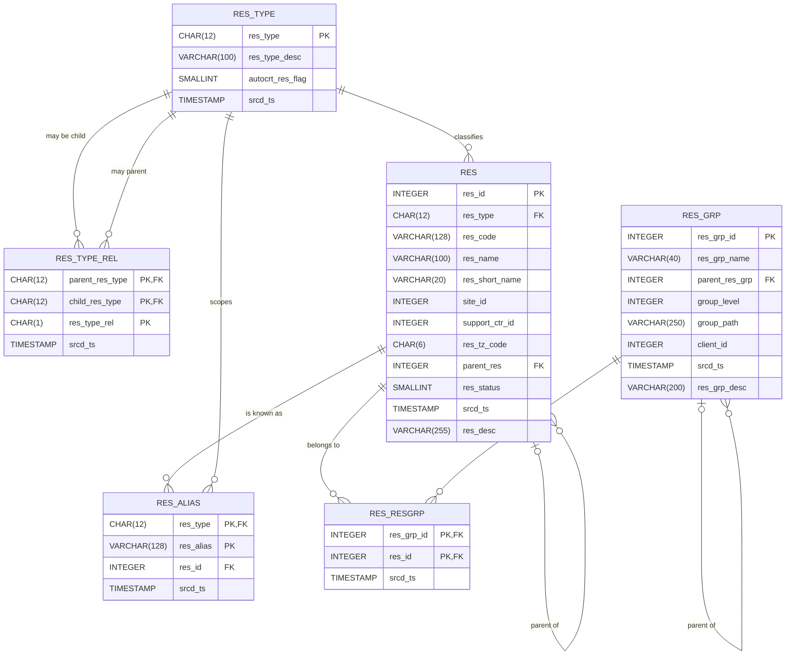
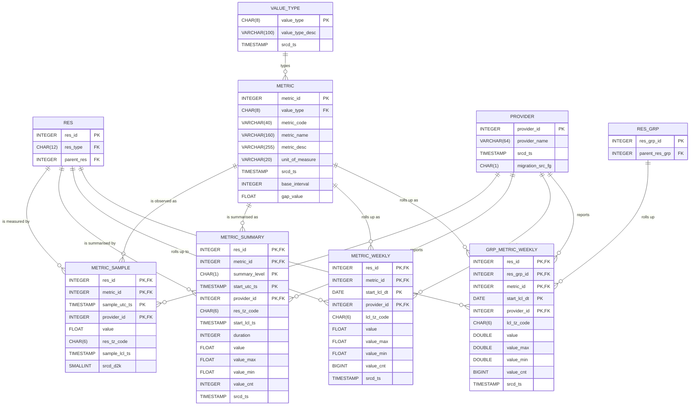
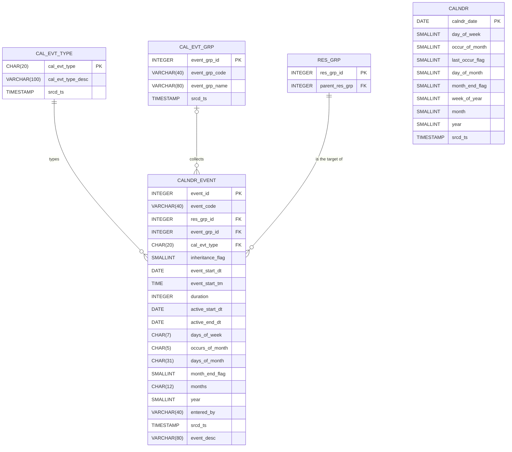
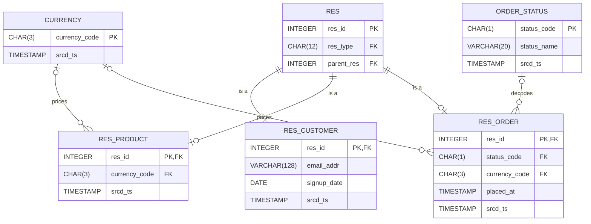
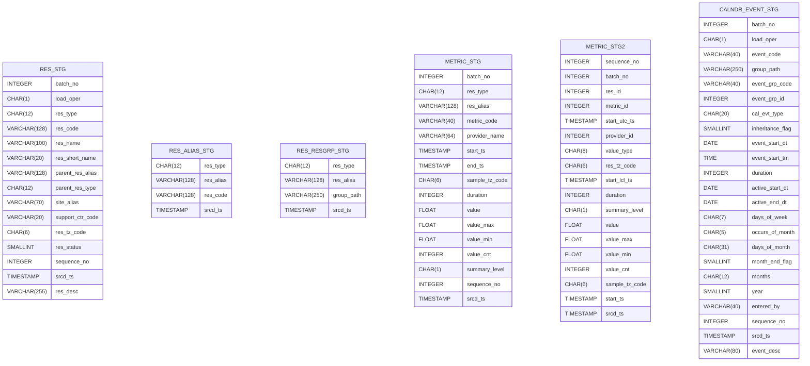

# `metrics.db` — Entity-Relationship Diagrams

ER diagrams for the mart in [`build/metrics.db`](../build/metrics.db),
generated from the live schema. Every column, type, primary key and
foreign key below comes from SQLite's own catalogue, so the diagrams match
what `make demo` builds.

The mart has 22 tables plus six staging tables, not counting the landing
and routing metadata. One graph of all of them is too wide to read, so there is a keys-only overview and
then one full-column diagram per layer.

> **Reading the diagrams.** `PK` marks a primary-key column and `FK` a
> declared foreign key; every foreign key here is enforced. A line ending
> in a crow's foot is the "many" side. `||` means the reference is
> required and `|o` means it may be null. A table that appears outside its
> own layer (for example `RES` in the metrics diagram) shows its key
> columns only.

## Overview — keys only

Every table that has a relationship, with its key columns. On GitHub, use
the diagram's zoom and pan controls.

```mermaid
erDiagram
    RES_TYPE {
        CHAR(12) res_type PK
    }
    RES_TYPE_REL {
        CHAR(12) parent_res_type PK, FK
        CHAR(12) child_res_type PK, FK
        CHAR(1) res_type_rel PK
    }
    RES {
        INTEGER res_id PK
        CHAR(12) res_type FK
        INTEGER parent_res FK
    }
    RES_ALIAS {
        CHAR(12) res_type PK, FK
        VARCHAR(128) res_alias PK
        INTEGER res_id FK
    }
    RES_GRP {
        INTEGER res_grp_id PK
        INTEGER parent_res_grp FK
    }
    RES_RESGRP {
        INTEGER res_grp_id PK, FK
        INTEGER res_id PK, FK
    }
    VALUE_TYPE {
        CHAR(8) value_type PK
    }
    METRIC {
        INTEGER metric_id PK
        CHAR(8) value_type FK
    }
    PROVIDER {
        INTEGER provider_id PK
    }
    METRIC_SAMPLE {
        INTEGER res_id PK, FK
        INTEGER metric_id PK, FK
        TIMESTAMP sample_utc_ts PK
        INTEGER provider_id PK, FK
    }
    METRIC_SUMMARY {
        INTEGER res_id PK, FK
        INTEGER metric_id PK, FK
        CHAR(1) summary_level PK
        TIMESTAMP start_utc_ts PK
        INTEGER provider_id PK, FK
    }
    METRIC_WEEKLY {
        INTEGER res_id PK, FK
        INTEGER metric_id PK, FK
        DATE start_lcl_dt PK
        INTEGER provider_id PK, FK
    }
    GRP_METRIC_WEEKLY {
        INTEGER res_id PK, FK
        INTEGER res_grp_id PK, FK
        INTEGER metric_id PK, FK
        DATE start_lcl_dt PK
        INTEGER provider_id PK, FK
    }
    CAL_EVT_TYPE {
        CHAR(20) cal_evt_type PK
    }
    CAL_EVT_GRP {
        INTEGER event_grp_id PK
    }
    CALNDR_EVENT {
        INTEGER event_id PK
        INTEGER res_grp_id FK
        INTEGER event_grp_id FK
        CHAR(20) cal_evt_type FK
    }
    RES_TYPE ||--o{ RES_TYPE_REL : "may be child"
    RES_TYPE ||--o{ RES_TYPE_REL : "may parent"
    RES |o--o{ RES : "parent of"
    RES_TYPE ||--o{ RES : "classifies"
    RES ||--o{ RES_ALIAS : "is known as"
    RES_TYPE ||--o{ RES_ALIAS : "scopes"
    RES_GRP |o--o{ RES_GRP : "parent of"
    RES ||--o{ RES_RESGRP : "belongs to"
    RES_GRP ||--o{ RES_RESGRP : "has member"
    VALUE_TYPE ||--o{ METRIC : "types"
    PROVIDER ||--o{ METRIC_SAMPLE : "reports"
    METRIC ||--o{ METRIC_SAMPLE : "is observed as"
    RES ||--o{ METRIC_SAMPLE : "is measured by"
    PROVIDER ||--o{ METRIC_SUMMARY : "reports"
    METRIC ||--o{ METRIC_SUMMARY : "is summarised as"
    RES ||--o{ METRIC_SUMMARY : "is summarised by"
    PROVIDER ||--o{ METRIC_WEEKLY : "reports"
    METRIC ||--o{ METRIC_WEEKLY : "rolls up as"
    RES ||--o{ METRIC_WEEKLY : "rolls up to"
    PROVIDER ||--o{ GRP_METRIC_WEEKLY : "reports"
    METRIC ||--o{ GRP_METRIC_WEEKLY : "rolls up as"
    RES_GRP ||--o{ GRP_METRIC_WEEKLY : "rolls up"
    RES ||--o{ GRP_METRIC_WEEKLY : "rolls up in"
    CAL_EVT_TYPE ||--o{ CALNDR_EVENT : "types"
    CAL_EVT_GRP |o--o{ CALNDR_EVENT : "collects"
    RES_GRP ||--o{ CALNDR_EVENT : "is the target of"
```

---

## 1 · Resources and groups

What exists. `RES` holds every resource of every type. `RES_ALIAS` maps
each name a provider uses to a `res_id`. `RES_GRP` is a hierarchy stored
as a path, and `RES_RESGRP` puts resources in groups.

- `RES.parent_res` and `RES_GRP.parent_res_grp` point at another row of
  the same table.
- `RES_TYPE_REL` lists which parent and child types may pair. No key
  enforces it on `RES.parent_res`; the loader checks it.
- `site_id`, `support_ctr_id` and `client_id` refer to tables the source
  diagrams don't show, so they carry no foreign key here.

---

## 2 · Metrics and aggregations

What was measured. A metric is a row in `METRIC`. `METRIC_SAMPLE` holds
one observation per resource, metric, provider and moment. The other three
tables are derived from it after every delivery.

---

## 3 · Calendar

What was planned. Every event targets a `RES_GRP`, belongs to at most one
event group, and has a type. `CALNDR` has no foreign keys: recurring
events expand by matching its day columns against the event's masks.

---

## 4 · Extensions for the shared corpus

Not in the source diagrams. `RES` has no column for an email, a signup
date, a currency, an order status or a placed-at time, so each resource
type that needs them gets a subtype table keyed on `res_id`, with its
codes in their own tables.

---

## 5 · Staging

The router fills these from the narrow landing on every delivery. They
hold names, not surrogates, so they have no foreign keys and no lines.
`METRIC_STG2` is `METRIC_STG` with every name resolved to an id.

---

## Regenerating

The diagrams were generated from `PRAGMA table_info` and
`PRAGMA foreign_key_list` over a database built from `schema/`. If the
schema changes, regenerate them; don't edit the blocks by hand.
